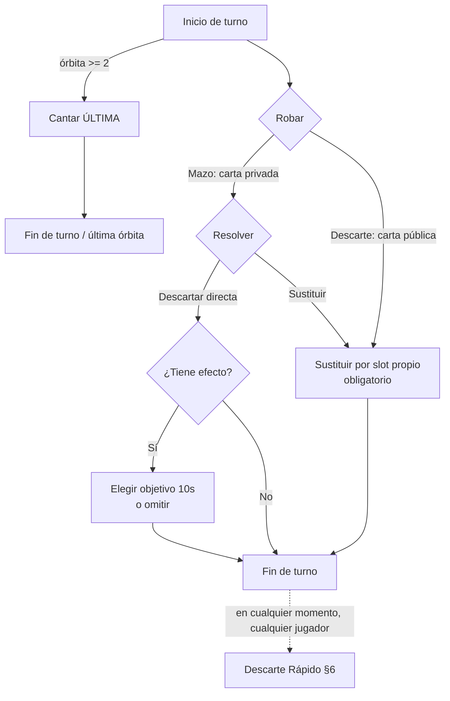

# 01 — GDD y Reglas Normativas: «TÓTEM» (título provisional)

> **Estado:** v1.0 — Fuente de verdad de diseño. Cualquier cambio de reglas se hace PRIMERO aquí y después se pide a un agente sincronizar el código.
> **Cómo usar este documento:** las secciones §3–§10 son *normativas* (el código debe implementarlas literalmente). Las §11–§13 son de dirección (el agente tiene margen creativo dentro de los límites indicados).

---

## 1. Visión

**Elevator pitch:** juego de cartas online para 2–6 jugadores, de memoria, riesgo y reflejos. Cada jugador custodia una fila de tótems boca abajo que **no puede ver**. Roba, descarta, espía e intercambia para quedarte con la menor puntuación… o vacía tu altar antes que nadie. Todo se juega **en primera persona**, sentado a una mesa de madera a la luz de las velas, con tus tótems siempre visibles en la parte inferior de la pantalla.

**Referencias mecánicas:** familia Cabo / Cambio / Golf / Rat-a-Tat Cat. Las mecánicas no son protegibles, pero **no** se usarán sus nombres, arte ni textos (marca propia, tema propio).
**Referencias de presentación:** Inscryption (mesa en primera persona, atmósfera), Hand of Fate, The Bazaar. Estética indie low-poly con luz cálida.

**Pilares de diseño (criterio para resolver cualquier duda futura):**
1. **Memoria frágil.** El juego premia recordar y los efectos sabotean tu mapa mental. Nada en la UI debe recordar por el jugador (ver E21 y §Seguridad en doc 02).
2. **Tensión permanente.** El Descarte Rápido mantiene a todos atentos incluso fuera de su turno.
3. **La información es el recurso.** Mirar, ocultar y farolear valen más que la suerte.
4. **Sesiones cortas y legibles.** 15–25 min por partida; reglas explicables en 2 minutos; apto para gente no jugona.
5. **Juicy indie.** Cada acción tiene peso físico: animación, sonido y partículas propias.

**Jugadores:** 2–6 humanos online en salas privadas con código; los huecos se pueden rellenar con bots. Sin emparejamiento público en MVP.

---

## 2. Componentes: el mazo (NORMATIVO)

Un mazo de **52 tótems**. Cada tótem tiene un **valor** (= puntos) y algunos tienen **efecto** que solo se activa al descartarlos directamente tras robarlos del mazo (§5).

| Valor | Copias | Nombre temático | Efecto al descartar desde robo |
|---|---|---|---|
| 0 | 2 | Luciérnaga | — (el mejor tótem: vale 0) |
| 1 | 4 | Ratón | — |
| 2 | 4 | Conejo | — |
| 3 | 4 | Tortuga | — |
| 4 | 4 | Ciervo | — |
| 5 | 4 | Cabra | — |
| 6 | 4 | Jabalí | — |
| 7 | 4 | Búho | **Vislumbre**: mira 1 tótem propio |
| 8 | 4 | Búho Real | **Vislumbre**: mira 1 tótem propio |
| 9 | 4 | Cuervo | **Espionaje**: mira 1 tótem rival |
| 10 | 4 | Cuervo Blanco | **Espionaje**: mira 1 tótem rival |
| 11 | 4 | Serpiente | **Trueque Ciego**: intercambia 1 propio ↔ 1 rival sin mirar |
| 12 | 4 | Zorro | **Trueque Ciego**: intercambia 1 propio ↔ 1 rival sin mirar |
| 13 | 2 | Chamán Oscuro | — en MVP (vale 13; en v1.1: mira un tótem cualquiera y decide si truecas) |

Iconografía obligatoria: silueta del animal + **número grande** en cada carta (nunca solo color; ver Accesibilidad §11).

---

## 3. Preparación de ronda (NORMATIVO)

1. Se baraja el mazo (Fisher-Yates con semilla del servidor; ver doc 02 §Determinismo).
2. Cada jugador recibe **4 tótems boca abajo** en una fila de slots con índices `0..3` (de izquierda a derecha desde el punto de vista del dueño). Los castigos posteriores ocupan slots `4..7`. Máximo **8 slots**.
3. Se voltea 1 carta del mazo al **descarte**. Si tiene efecto, **no se activa** (E1). Solo la carta superior del descarte es visible; el historial del descarte **no** es consultable (la memoria también aplica al descarte).
4. **Vislumbre inicial:** durante 10 s, cada jugador elige 2 de sus tótems y los ve en secreto (simultáneo para todos). Si en el segundo 7 no ha elegido 2, se le muestran automáticamente los que falten empezando por el slot 0.
5. Empieza un jugador aleatorio en la ronda 1; en rondas siguientes empieza quien menos puntuó en la ronda anterior (desempate: aleatorio entre empatados).

---

## 4. El turno (NORMATIVO)

Turnos en sentido horario. Contador de **órbitas**: la órbita N termina cuando todos han jugado N turnos.

**Paso A — Inicio de turno.** El jugador activo puede **cantar ¡ÚLTIMA!** (§7) en lugar de robar. Solo permitido a partir de la **órbita 2** (E19). Si canta, su turno termina aquí.

**Paso B — Robar (obligatorio si no cantó).** Dos opciones:
- **Del mazo:** la carta se muestra **solo al ladrón** (en la escena: la sostiene frente a la cámara; los demás ven el dorso).
- **Del descarte:** toma la carta superior; es información pública.

**Paso C — Resolver la carta robada.**
- Si robó **del mazo**, elige una:
  - **C1 — Descartarla directamente.** Va al descarte boca arriba. Si tiene efecto, **se activa** (§5).
  - **C2 — Sustituirla.** Elige un slot propio ocupado: la robada entra **boca abajo** en ese slot (él sabe su valor porque acaba de verla) y la que estaba sale al descarte **boca arriba**. El efecto de la carta que sale **no se activa**.
- Si robó **del descarte**, **solo puede C2** (sustitución obligatoria; no puede devolverla al descarte, E2).

**Paso D — Fin de turno.** Pasa el turno al siguiente jugador.

**Reloj de turno:** 30 s (configurable). Si expira: acción automática = robar del mazo y descartarla **sin activar efecto** (E15, para no premiar el AFK).

**Descarte Rápido (§6)** está abierto de forma continua durante las fases de turno (ver ventanas exactas en §6), para **todos** los jugadores, también fuera de su turno.

---

## 5. Efectos (NORMATIVO)

Se activan **únicamente** al descartar directamente la carta recién robada del mazo (C1). Nunca al sustituir, nunca en Descarte Rápido, nunca en la carta inicial del descarte.

| Efecto | Cartas | Resolución exacta |
|---|---|---|
| **Vislumbre** | 7, 8 | Eliges 1 slot propio ocupado → ves su valor **en privado** durante 3 s. Los demás ven *qué slot* miraste, no el valor. |
| **Espionaje** | 9, 10 | Eliges 1 slot ocupado de un rival → ves su valor **en privado** 3 s. El rival (y todos) ven *qué slot suyo* fue espiado. |
| **Trueque Ciego** | 11, 12 | Eliges 1 slot propio ocupado + 1 slot ocupado de un rival → se intercambian físicamente, ambos boca abajo. Nadie ve valores. Todos ven qué slots se cruzaron. |

Reglas comunes a todos los efectos:
- Son **opcionales**: botón «Omitir» siempre disponible.
- **10 s** para elegir objetivo; si expira, el efecto se pierde (evento `EFFECT_SKIPPED`, E9).
- Objetivos inválidos: slots vacíos; jugadores **sellados** por ÚLTIMA (E10/E12); en Trueque, uno mismo como "rival" (E11).
- Si no existe ningún objetivo válido, el efecto se omite automáticamente (E8).
- Mientras un efecto espera objetivo, el Descarte Rápido queda **cerrado** para todos (motivo: los objetivos no deben desaparecer a mitad de selección).

---

## 6. Descarte Rápido y castigo (NORMATIVO)

La mecánica de reflejos/memoria que da identidad al juego.

- **Condición:** crees que un tótem propio boca abajo tiene **exactamente el mismo valor** que la carta superior del descarte.
- **Quién y cuándo:** cualquier jugador (también fuera de su turno), en cualquier momento dentro de las **ventanas abiertas**: fases `TURN_DRAW` y `TURN_RESOLVE`. Ventanas **cerradas**: vislumbre inicial, `EFFECT_TARGETING`, revelación y puntuación de fin de ronda (E20: intento en ventana cerrada → rechazado sin castigo, feedback «ahora no»).
- **Acción:** tocas ese tótem propio → se revela **públicamente**:
  - **Acierto:** el tótem va al descarte encima (ahora esa es la nueva carta superior… y también es matchable: **las cadenas son posibles y deseables**). Su efecto no se activa. Te quedas con un slot menos (el slot queda **hueco**, no se compacta, E21). Si te quedas con **0 tótems**, ganas la ronda al instante (§7, E6).
  - **Fallo:** todos ven el tótem durante 2 s (la fuga de información es parte del castigo), vuelve boca abajo a su slot, y **robas 1 tótem de castigo** del mazo que se coloca boca abajo en tu primer slot libre, **sin que nadie lo vea** (tampoco tú). Además quedas **bloqueado 5 s** para nuevos intentos (solo tú).
- **Arbitraje de simultaneidad (E5):** el servidor procesa el primer intento recibido sobre una carta superior dada; los intentos que lleguen sobre **esa misma** carta superior en los 300 ms siguientes se cancelan sin castigo («demasiado tarde»). Pasados 300 ms, cualquier intento se evalúa contra la situación vigente en el momento de recepción (E7) — puede fallar y castigarse.
- **Mano llena (E13):** si te corresponde un castigo con los 8 slots ocupados, en su lugar sumas **+5 puntos** directos a tu marcador de la ronda.
- **v1.1 — Modo «Salvaje» (desactivado por defecto):** puedes hacer Descarte Rápido sobre el tótem de **otro** jugador si lo recuerdas; al acertar, además le regalas uno de tus tótems (eliges cuál sin mirarlo). Al fallar, castigo doble (+2 tótems, o +10 pts si mano llena, E14). No implementar en MVP; dejar hueco en config.

---

## 7. Fin de ronda (NORMATIVO)

Tres desencadenantes, cualquiera termina la ronda:

1. **¡ÚLTIMA!** Un jugador la canta al inicio de su turno (Paso A). Desde ese momento sus tótems quedan **sellados**: no pueden ser objetivo de Espionaje ni Trueque, y él no puede hacer Descartes Rápidos ni volver a jugar. Cada uno de los demás jugadores juega **exactamente 1 turno más** y se revela todo.
2. **Altar vacío.** Un jugador se queda con 0 tótems (por Descarte Rápido o sustituciones+matches). Fin **inmediato**, incluso a mitad del turno de otro (E6): gana la ronda con 0 puntos y **bonus −5** a su total.
3. **Mazo agotado por 2ª vez.** La 1ª vez que el mazo se vacía, se rebaraja el descarte salvo la carta superior (evento público `DECK_RESHUFFLED`). Si vuelve a vaciarse, la ronda termina automáticamente y se revela todo (E3).

**Revelación:** todas las manos se voltean a la vez con pausa dramática (ver §11); después, puntuación.

---

## 8. Puntuación y fin de partida (NORMATIVO)

- Cada jugador suma los **valores de sus tótems restantes**; esa es su puntuación de ronda.
- **Cantor de ÚLTIMA:** si su suma es **estrictamente la más baja** de la mesa, anota **0** en la ronda (recompensa por el riesgo). Si empata o no es la más baja, anota su suma **+10**. Los demás siempre anotan su suma tal cual.
- **Ganador por altar vacío:** anota 0 y además **−5** al total acumulado (el total puede quedar negativo; permitido).
- **Modos de partida:**
  - **Ronda rápida:** 1 ronda; gana la menor puntuación (desempate: menos tótems restantes; si persiste, empate compartido).
  - **Clásico a 100 (por defecto):** se acumulan rondas. Cuando alguien alcanza **≥ 100**, la partida termina al final de esa ronda y gana el **total más bajo**.
  - v1.1: regla «Kamikaze» — quedar en exactamente 100 te devuelve a 50. Off por defecto.

---

## 9. Tabla de configuración (NORMATIVO — single source of truth → `packages/core/src/config.ts`)

Todos los números del juego viven aquí. Nada de constantes mágicas repartidas por el código.

| Clave (código) | Defecto | Rango válido | Descripción |
|---|---|---|---|
| `minPlayers` / `maxPlayers` | 2 / 6 | 2–6 | Humanos + bots por sala |
| `initialSlots` | 4 | 3–5 | Tótems iniciales por jugador |
| `maxSlots` | 8 | 6–10 | Tope de mano (E13) |
| `initialPeekCount` | 2 | 1–3 | Tótems vistos en el vislumbre inicial |
| `initialPeekSeconds` | 10 | 5–20 | Duración del vislumbre inicial |
| `autoPeekAtSecond` | 7 | — | Autocompletar elección de vislumbre |
| `turnSeconds` | 30 | 15–60 | Reloj de turno |
| `effectTargetSeconds` | 10 | 5–20 | Tiempo para elegir objetivo de efecto |
| `privateRevealSeconds` | 3 | 2–5 | Duración de Vislumbre/Espionaje en pantalla |
| `matchFailPenaltyCards` | 1 | 1–2 | Tótems de castigo por fallo |
| `matchFailLockoutSeconds` | 5 | 3–10 | Bloqueo tras fallo (solo infractor) |
| `matchFailPublicRevealSeconds` | 2 | 1–4 | Cuánto ven todos el tótem fallado |
| `matchArbitrationMs` | 300 | 150–500 | Ventana de cancelación sin castigo (E5) |
| `fullHandPenaltyPoints` | 5 | 3–13 | Puntos si castigo con mano llena |
| `ultimaMinOrbit` | 2 | 1–3 | Primera órbita en que se puede cantar |
| `ultimaFailPenaltyPoints` | 10 | 5–15 | Penalización al cantor si no es el mínimo |
| `emptyAltarBonusPoints` | −5 | −10–0 | Bonus por vaciar el altar |
| `gameEndScore` | 100 | 50–200 | Umbral de fin en modo Clásico |
| `revealPauseSeconds` | 4 | 2–8 | Pausa dramática de revelación |
| `reconnectGraceSeconds` | 60 | 30–180 | Antes de que un bot tome el asiento |
| `botTurnDelayMsMin/Max` | 800 / 1500 | — | Humanización de bots |
| `wildModeEnabled` | false | bool | Modo Salvaje v1.1 |
| `kamikazeRule` | false | bool | Regla 100→50 v1.1 |

---

## 10. Casos límite normativos (E1–E22)

Los agentes deben implementar y **testear** cada uno de estos. Referéncialos por código (E5, E13…) en prompts, tests y commits.

- **E1.** La carta inicial del descarte nunca activa efecto.
- **E2.** Carta robada del descarte: ilegal devolverla al descarte; solo sustitución.
- **E3.** Mazo vacío al robar → rebarajar descarte menos la superior. Si tras rebarajar sigue vacío (descarte tenía solo 1 carta), robar del mazo es ilegal: el jugador solo puede robar del descarte o cantar ÚLTIMA; si tampoco puede, la ronda termina (equivale al 2º agotamiento).
- **E4.** Castigo de Descarte Rápido con mazo vacío incluso tras rebarajar → +5 puntos en lugar de carta (mismo tratamiento que E13).
- **E5.** Intentos de match simultáneos → arbitraje 300 ms (§6).
- **E6.** Acertar match con tu último tótem → victoria de ronda instantánea, cancela cualquier turno/efecto en curso.
- **E7.** Un match que llega justo tras cambiar la carta superior se evalúa contra la carta superior **en el momento de recepción en el servidor**, nunca contra lo que el cliente veía.
- **E8.** Efecto sin objetivos válidos → se omite automáticamente con evento explícito.
- **E9.** Desconexión durante selección de objetivo → aplica el timeout de 10 s (efecto omitido). Tras `reconnectGraceSeconds`, un bot ocupa el asiento hasta reconexión.
- **E10.** Tótems del cantor de ÚLTIMA: sellados como objetivo de todo efecto.
- **E11.** Trueque Ciego entre dos slots propios: ilegal.
- **E12.** Espiar al cantor sellado: ilegal (el cliente ni siquiera lo ofrece como objetivo).
- **E13.** Castigo con 8 slots ocupados → +5 puntos (§6).
- **E14.** (v1.1) Castigo doble del modo Salvaje con mano llena → +10 puntos.
- **E15.** Timeout de turno → auto: robar del mazo y descartar **sin** activar efecto.
- **E16.** Abandono definitivo → un bot juega su asiento hasta el fin de la partida. Si solo queda 1 humano en la sala, se le ofrece terminar con victoria o seguir contra bots.
- **E17.** Con 2 jugadores todas las reglas aplican sin cambios.
- **E18.** Reconexión: el jugador recibe un snapshot filtrado (su vista) + el log de eventos públicos perdidos. **No** se le re-muestra nada oculto: lo olvidado, olvidado está.
- **E19.** Cantar ÚLTIMA en la órbita 1: ilegal (botón deshabilitado, servidor rechaza).
- **E20.** Match en ventana cerrada: rechazado sin castigo, con feedback.
- **E21.** Los slots vaciados **no se compactan**: quedan como huecos visibles. Las posiciones son estables porque son el ancla de la memoria de todos los jugadores. (Decisión de diseño central: no negociable.)
- **E22.** La carta robada del mazo solo la ve el ladrón. Si la sustituye, su valor no se hace público jamás (hasta revelación o descarte futuro). El log interno del servidor sí la registra (replays).

---

## 11. Experiencia en primera persona (dirección con requisitos duros)

**Formato «mesa con personajes»** (D-042, investigación en `docs/05`). Primera persona sentado a una mesa que es la protagonista del encuadre; los rivales son personajes 3D sentados alrededor que juegan las cartas con las manos.

**Asientos.** Tú siempre en el asiento 0. Los rivales se reparten en **herradura**, nunca en círculo completo: ángulos φ alrededor del centro (0° = tú) en [100°, 260°] — 2 jugadores: 180 · 3: 125/235 · 4: 110/180/250 · 5: 100/153/207/260 · 6: 100/140/180/220/260. La mesa crece con 5–6 jugadores. Delante de cada personaje, su fila de tótems sobre la mesa (huecos incluidos, E21).

**Cámara.** FOV vertical ≈ 55° (se abre en pantallas estrechas para conservar ≥ 80° horizontales), oscilación idle de «respiración». Dos poses:
- **«Mesa»** (por defecto): ojo ~0,45 m sobre el tablero, inclinación ~20°. Caras de los rivales en el tercio superior, mazo y descarte en el centro, tus tótems en la franja inferior.
- **«Mis tótems»**: inclinación ~55°; tus tótems llenan la mitad inferior y los rivales quedan en el borde superior. Se alterna con Space, con el botón de vista o arrastrando en vertical; transición ≤ 0,3 s.
- **Giro lateral** ±30° (arrastre horizontal o flechas) que vuelve solo al centro al soltar. Sin giro libre de 360°.
- «Menos movimiento» desactiva la respiración, el giro y las transiciones animadas (cambio de pose instantáneo).

**Requisito duro:** tus tótems (slots 0..7, huecos incluidos) siempre visibles en **ambas** poses, en una fila en la parte inferior de la pantalla y en el mismo orden de izquierda a derecha que la barra 2D. Lo comprueba `scene/layout.test.ts` para 4 y 8 slots y 2–6 jugadores.

**Personajes.** Marionetas rígidas low-poly (torso, cabeza, brazos de dos piezas, manos), sin skinning, animadas por el `presenter` con GSAP: idle, su turno, robar del mazo o del descarte, descartar, sustituir, Vislumbre/Espionaje/Trueque, golpe de Descarte Rápido, ¡ÚLTIMA!, reacción final. Seis animales totémicos originales (búho, zorro, oso, ciervo, serpiente, cuervo) distinguibles por silueta y color, asignados desde el avatar del lobby. **La carta que sostiene un rival se pinta siempre por el dorso** (I2, E22). Tus manos solo aparecen durante tus acciones. Una animación nunca retrasa ni bloquea la entrada del Descarte Rápido: el `presenter` puede recortarlas.

**Interacción.** Solo lo legal es interactuable: los objetos válidos para tu siguiente acción llevan outline/brillo; el resto no responde. La lista de acciones legales la dicta el servidor (campo `legal` de la vista, doc 02), la UI nunca la calcula sola.

**Tabla de feedback por acción** (duraciones orientativas; el agente puede ajustar ±30 %):

| Acción | Animación | Sonido | Duración |
|---|---|---|---|
| Robar del mazo | La carta vuela a tu mano y se inclina hacia la cámara (solo tú ves la cara) | Roce de cartón + nota suave | 0,6 s |
| Descartar | Arco hasta el descarte, golpe seco | Slap de madera | 0,5 s |
| Sustituir | Cruce de las dos cartas en el aire | Doble roce | 0,8 s |
| Vislumbre | Tu tótem se alza 15° hacia ti con halo de vela | Campanilla grave | 3 s |
| Espionaje | Un cuervo espectral vuela del descarte al tótem rival y te «trae» la visión (viñeta circular) | Aleteo + susurro | 3 s |
| Trueque Ciego | Zarcillos de humo cruzan los dos tótems | Silbido de viento | 1,2 s |
| Match acierto | El tótem salta al descarte con chispas verdes | Golpe + campana | 0,7 s |
| Match fallo | Tótem tiembla, flash rojo, todos lo ven 2 s, carta de castigo se desliza hacia ti | Cuerda rota + gruñido | 3 s |
| ¡ÚLTIMA! | Puñetazo en la mesa (cámara vibra), gong, cadenas de luz sellan los tótems del cantor | Gong grave | 1,5 s |
| Revelación final | Todas las manos se voltean en oleada, cámara se eleva ligeramente | Redoble suave | 4 s |

**UI: diegética + HUD 2D en esquinas y barra inferior.** En 3D: vela-reloj delante del jugador activo, campana física de ÚLTIMA a tu derecha, nombre sobre cada rival. En 2D:
- **Barra inferior de slots**: una casilla por cada uno de tus slots, **por posición**: hueco, ocupado, resaltado legal, sellado, bloqueo tras fallo (cuenta atrás) y selección actual. Se elige con 1–8, con A/D + Enter o tocando. **Nunca muestra valores**, ni los que ya viste: olvidarlos es la mecánica central. Única excepción: durante una vista privada (3 s) la casilla de ese slot muestra el valor a la vez que la carta 3D.
- Arriba izquierda: carta superior del descarte en grande + última acción («Ana sustituyó su slot 2») + marcador compacto.
- Arriba centro: temporizador numérico (vela 2D) + quién juega.
- Arriba derecha: acciones legales con su tecla, alimentadas por `legal` del servidor.
- Laterales: log de subtítulos y rueda de emotes (6 gestos sonoros no tóxicos: saludo, risa, sospecha, aplauso, «uf», «piensa rápido»), que nunca tapan tus tótems ni a los personajes. Ajustes y nombre de sala, siempre accesibles.
- Móvil: solo en horizontal (812×375 como referencia mínima).

**Onboarding:** tutorial guiado de ~3 min contra 1 bot con guion fijo: (1) vislumbre inicial, (2) robar y sustituir, (3) robar y descartar un 7 → Vislumbre, (4) el bot descarta un 4 y te pide hacer match con tu 4 conocido, (5) fallo provocado para enseñar el castigo, (6) cantar ÚLTIMA y puntuar.

**Accesibilidad (requisitos duros):** número grande + icono en toda carta (nunca solo color); modo daltónico (paleta alternativa + patrones); opción de sala «tiempo ×1,5» que multiplica todos los timers; subtítulos de eventos en un log lateral («Ana ha espiado tu tótem 3»); todos los sonidos con alternativa visual.

---

## 12. Dirección de arte y audio

**Estilo: pixel-art en 3D (referencia de estilo Megabonk; formato de mesa inspirado en Liar's Bar, sin copiar sus diseños: nada de bar, neón ni armas).** Modelos low-poly; texturas diminutas (16–64 px) generadas por código con `NearestFilter` y sin mipmaps; render interno a ~360 px de alto (ajustable) escalado a pantalla sin suavizado; colores planos y saturados; niebla de distancia; sin film grain. Postproceso: viñeta + cuantización a la paleta cerrada del mapa con tramado ordenado. Tono: misterio nocturno.

**Mapas.** Un mapa es un descriptor de datos `{ id, mesa, fondo, luces, paleta, ambiente }` sobre la misma geometría de asientos; es solo cosmético (ni reglas ni protocolo). v1 prevé 3 mapas elegidos por el anfitrión; hoy existe solo el **nocturno con velas**: mesa redonda de madera vieja protagonista, velas, claro de bosque pixel al fondo bajo la luna.

**Paleta base (hex):** fondo `#1B1725` · madera `#6E4B2A` / `#8C6239` · luz de vela `#FFB35C` · acento místico `#7BE0C8` · peligro/castigo `#E0565B` · marfil de cartas `#F2E8D5`. Cada mapa la amplía a una paleta cerrada de 24–32 colores; la UI 2D usa su propia paleta fija (contraste y modo daltónico).

**Tipografías (Google Fonts):** título/display → *Fraunces* o *Caudex*; UI/números → *Nunito Sans* o *Inter* (números tabulares).

**Audio:** ambiente nocturno (grillos, fuego crepitante); foley de madera y cartón; leitmotiv de 3–4 notas distinto por efecto; música folk lo-fi mínima que sube de intensidad tras cantarse ÚLTIMA.

**Placeholders CC0 para desarrollo (hasta la fase de arte):** Kenney (cards, boardgame pack, UI), Quaternius (animales low-poly), Freesound/Kenney Audio. El arte final se aborda en F6 (doc 03); antes de eso, prohibido invertir tiempo en assets.

---

## 13. Alcance por versiones

| Versión | Contenido |
|---|---|
| **MVP «jugable con amigos»** | Salas privadas con código, reglas §3–§8 completas sin v1.1, 3 efectos, bots Random+Greedy, arte placeholder digno, es/en, deploy web por link |
| **V1.0 (itch.io)** | Arte y audio propios, tutorial, accesibilidad completa, 2 modos de partida, reconexión pulida |
| **V1.1** | Modo Salvaje, Chamán Oscuro activo, regla Kamikaze, espectadores |
| **V1.2 (idea)** | **Modo cooperativo «El Ritual»**: la mesa entera contra un Espíritu controlado por reglas que roba y sabotea; objetivo colectivo: bajar la suma total de la mesa por debajo de X antes de N rondas. (Responde al interés por lo cooperativo; diseñar solo cuando el competitivo esté probado.) |
| **Futuro** | Cosméticos de mesa/tótems/velas, torneos, ranked |

---

## 14. Reglas v2 (NORMATIVO — implementadas en `core`)

> Enmiendan §2, §5, §6, §8 y §9. ADR: D-043 y D-046…D-058 en `decisiones.md`. Tickets #4, #13–#16.

**Efectos (sustituyen a la tabla de §5; «Pasar» = `EFFECT_SKIP` en todos):**

| Valor | Efecto | Resolución |
|---|---|---|
| 7 | Vislumbre | sin cambios |
| 8 | **Doble Robo** (diferido) | marcador sobre tu altar; en tu siguiente robo **del mazo** ves 2 y te quedas 1; la otra va al descarte sin efecto |
| 9 | Espionaje | sin cambios |
| 10 | **Ojo Compartido** | 1 slot propio + 1 de un rival no sellado, ambos en privado |
| 11 | Trueque Ciego | sin cambios |
| 12 | **Revuelo** | trueque ciego entre dos casillas cualesquiera de altares no sellados, salvo dos propias |
| 13 | **Trueque Vidente** | mirar 1 tótem cualquiera; luego trueque propio↔rival opcional (dos relojes) |

**Robo de efecto (D-043):** tras un C1 con efecto, ventana `stealWindowMs` con el Descarte Rápido abierto; el primer rival que acierta se lleva el efecto.
**Carreras y Cadena (#16):** cada descarte normal abre una carrera con un acierto máximo; el tótem acertado no es casable; −1 (`chainBonusPerLink`) por eslabón desde el 2.º, aparte de la comparación de ÚLTIMA.
**Presagios (#15, `omensEnabled`):** Prisa (Conejo 2: turno 15 s), Calma (Tortuga 3: 45 s), Destello (Luciérnaga 0: el tótem fallado se ve 4 s).
**Salvaje y Kamikaze (#4):** opciones de sala, apagadas por defecto.

**Config añadida a §9:** `stealWindowMs` 1500 (1000–2500) · `chainBonusPerLink` −1 (−3–0) · `omensEnabled` false · `omens` (tabla carta→modificador) · `wildModeEnabled` false · `wildFailPenaltyFactor` 2 (2–3) · `kamikazeRule` false · `kamikazeResetScore` 50 (0–99).

**Casos límite nuevos:**
- **E23.** C1 con efecto abre la ventana de robo (también sin objetivos para el dueño); no con C2, E15 ni la carta inicial.
- **E24.** El dueño acierta en la ventana: match normal, conserva el efecto, la ventana se cierra.
- **E25.** Un solo robo por carta: el primer acierto gana; después la carrera está cerrada (rechazo sin castigo).
- **E26.** Ladrón sellado/bloqueado: no intenta. Sin objetivos (E8): efecto perdido, no vuelve al dueño.
- **E27.** Fin de ronda (E6) durante la ventana o el efecto robado: lo cancela.
- **E28.** El robo cuenta como eslabón de Cadena sin bonus propio; resultados privados solo al ladrón.
- **E29.** El Doble Robo se pierde al robar del descarte, cantar ÚLTIMA, expirar el turno o acabar la ronda.
- **E30.** El Doble Robo no es acumulable.
- **E31.** Con 1 carta en el mazo solo ves esa; con el mazo vacío se rebaraja (E3) y luego se roban 2.
- **E32.** La carta rechazada del Doble Robo nunca activa efecto y es matchable.
- **E33.** Revuelo con un único altar rival de ≥ 2 slots es válido; con < 2 casillas válidas o solo propias → E8. Ojo Compartido se reduce a Vislumbre/Espionaje si falta rival/slot propio.
- **E34.** Trueque Vidente sin rival válido: solo el paso 1, sobre un tótem propio.
- **E35.** El Descarte Rápido sigue cerrado en los dos pasos del Chamán.
- **E36.** La carta inicial del descarte no activa su presagio.
- **E37.** Prisa/Calma no alteran el reloj en curso; el rebarajado no cambia el presagio.
- **E38.** Carrera sin acierto rompe la Cadena; los fallos no la rompen ni la alargan; robar del descarte no abre carrera.
- **E39.** Acierto que vacía el altar en eslabón ≥ 2: acumula el bonus de Cadena con el −5.
- **E40.** Kamikaze: total exactamente igual a `gameEndScore` → `kamikazeResetScore` (solo Clásico).
- **E41.** Salvaje: acierto sobre rival = regalo a ciegas al hueco abierto; fallo = castigo ×`wildFailPenaltyFactor` (E14 con mano llena); sellados no atacables.
